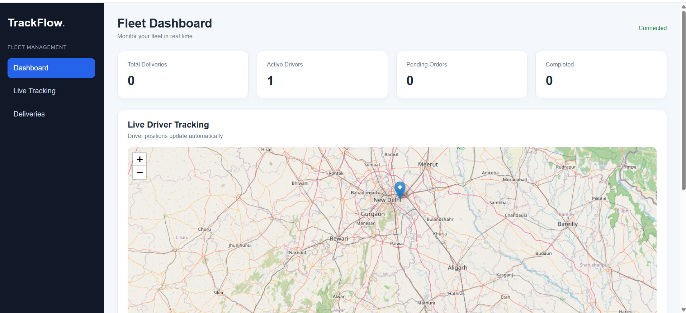

# TrackFlow — Real-Time Fleet & Delivery Tracking

TrackFlow is a web-based fleet tracking dashboard built with **Node.js, Express, Socket.IO, EJS, and Leaflet**. It demonstrates real-time GPS location sharing, live driver markers, and basic delivery management.

## Project Screenshot

Add a screenshot of your running application to `screenshots/dashboard.png` and it will appear here on GitHub:



**How to add the screenshot**
1. Run the app locally with `node app.js`.
2. Open `http://localhost:3000` in your browser.
3. Capture a screenshot of the actual dashboard.
4. Create a folder named `screenshots` in the project root.
5. Save the image as `screenshots/dashboard.png`.

> The screenshot file must be committed to the repository for it to display on GitHub.

## Features

- Real-time GPS updates using Socket.IO and the browser Geolocation API
- Live driver markers on an interactive Leaflet map
- Driver connection and disconnection handling
- Dashboard statistics for total, pending, and completed deliveries
- Create delivery records with customer, pickup, and destination details
- Update delivery statuses
- Responsive dashboard layout

## Tech Stack

- **Frontend:** HTML, CSS, JavaScript, EJS
- **Backend:** Node.js, Express.js
- **Real-time communication:** Socket.IO
- **Maps:** Leaflet and OpenStreetMap
- **Package management:** npm

## Project Structure

```text
realtime-tracker/
├── app.js
├── package.json
├── package-lock.json
├── views/
│   └── index.ejs
├── public/
│   ├── css/
│   │   └── style.css
│   └── js/
│       └── script.js
├── screenshots/
│   └── dashboard.png
├── .gitignore
└── README.md
```

## Getting Started

### Prerequisites

- Node.js and npm installed
- A modern browser
- Internet access to load OpenStreetMap tiles

### Installation

Clone the repository and enter the project folder:

```bash
git clone https://github.com/ananyasri20/Trackflow-realtime_tracker.git
cd Trackflow-realtime_tracker
```

Install dependencies:

```bash
npm install
```

Start the server:

```bash
node app.js
```

Open [http://localhost:3000](http://localhost:3000) in your browser and allow location access when prompted.

## Testing Live Tracking

1. Open the app in two browser tabs.
2. Allow location access in both tabs.
3. Each connected tab should appear as a driver connection.
4. Create a delivery from the dashboard and try changing its status.

Browser geolocation generally works on `localhost`. The device or browser must grant location permission.

## Current Limitations

- Driver and delivery data are stored in memory and reset when the server restarts.
- Authentication and role-based access are not implemented yet.
- Driver assignment and public customer tracking may require additional UI/backend work.
- This project is a learning/demo application and is not intended for production fleet operations.

## Future Improvements

- MongoDB persistence for drivers, deliveries, and trip history
- Admin and driver authentication with protected APIs
- Driver assignment interface
- Customer-facing tracking page using a tracking ID
- Trip playback, delivery analytics, and estimated arrival times
- Deployment with environment-based configuration

## Author

**Ananya Srivastava**

- GitHub: [ananyasri20](https://github.com/ananyasri20)

---

Built as a full-stack project to explore real-time web applications, geolocation, maps, and delivery workflows.
